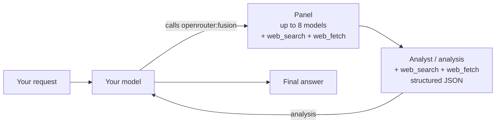

> ## Documentation Index
> Fetch the complete documentation index at: https://openrouter.ai/docs/llms.txt
> Use this file to discover all available pages before exploring further.

# Auto Router

> Automatically select the best model for your prompt

The Auto Router automatically selects the best model for your prompt. It is powered by the market: the aggregate spend of millions of people using OpenRouter, measured over a trailing 7-day window for each task type. Think of it like a market index that stays up to date and gets more efficient as more people use OpenRouter. See [How It Works](#how-it-works) and the [Cost Tier](#cost-tier) settings.

Two slugs run this router:

* **[Auto](https://openrouter.ai/openrouter/auto)** (`openrouter/auto`) — works like any other model slug; sending it as the `model` is all you need to do.
* **[Auto Beta](https://openrouter.ai/openrouter/auto-beta)** (`openrouter/auto-beta`) — the early-access track. New routing behaviors land here before they reach `openrouter/auto`. Everything on this page applies to it too, except that per-request settings must use the plugin id `auto-beta-router` instead of `auto-router`:

```typescript theme={null}
const completion = await openRouter.chat.send({
  model: 'openrouter/auto-beta',
  messages: [{ role: 'user', content: 'Summarize this paragraph' }],
  plugins: [{ id: 'auto-beta-router', cost_tier: 'medium' }],
});
```

<Warning>
  Each slug only reads settings sent under its own plugin id. Settings sent under the other slug's plugin id are accepted but silently ignored: `allowed_models`, `excluded_models`, and `cost_tier` will have no effect on the request.
</Warning>

## Overview

Instead of manually choosing a model, let the Auto Router analyze your prompt and select a model based on what the OpenRouter community, in aggregate, uses for that kind of work. The router considers factors like task type, model capabilities, tool support, and cost.

## How It Works

The Auto Router routes on the wisdom of the market: what millions of people, in aggregate, spend on for exactly the kind of task your prompt represents. The rankings are computed from aggregate anonymized spend statistics. Prompts are classified in-flight without requiring retention.

1. **Classify the task.** A fast, lightweight classifier assigns each prompt one of \~30 fine-grained task types — for example `code:debugging`, `agent:multi_step_planning`, `qa_knowledge`, `math`, `customer_support`, or `research_report`.
2. **Rank by real-world spend share.** For that task type, the router looks up which models the OpenRouter community actually spends on over a trailing 7-day window — the "Share of Spend" view from the [task-spend rankings](https://openrouter.ai/rankings#task-spend). This is a live signal: when developers migrate a workload to a new model, the router follows within days, with no retraining or manual curation.
3. **Apply your cost tier.** The [`cost_tier`](#cost-tier) setting selects a cost band: `low`, `medium`, `high`, `xhigh`, or `max`.
4. **Route with fallbacks.** The top surviving models (in market spend-share order) become the primary pick plus fallbacks, after honoring your account-level model and provider restrictions, guardrails, ZDR policies, `allowed_models` restrictions, and output-modality requirements. If classification or rankings are ever unavailable, the router degrades gracefully to a default model set — a request never fails because routing infrastructure hiccuped.

To see which task type your prompt was classified as, opt in to [router metadata](/docs/guides/features/router-metadata) with the `X-OpenRouter-Metadata: enabled` header. The router stage in `openrouter_metadata.pipeline` then carries the tag at `data.task_type`, such as `code:debugging`. The field is absent when classification is unavailable.

## Usage

Set your model to `openrouter/auto`:

<CodeGroup>
  ```typescript title="TypeScript SDK" lines theme={null}
  import { OpenRouter } from '@openrouter/sdk';

  const openRouter = new OpenRouter({
    apiKey: '<OPENROUTER_API_KEY>',
  });

  const completion = await openRouter.chat.send({
    model: 'openrouter/auto',
    messages: [
      {
        role: 'user',
        content: 'Explain quantum entanglement in simple terms',
      },
    ],
  });

  console.log(completion.choices[0].message.content);
  // Check which model was selected
  console.log('Model used:', completion.model);
  ```

  ```typescript title="TypeScript (fetch)" expandable lines theme={null}
  const response = await fetch('https://openrouter.ai/api/v1/chat/completions', {
    method: 'POST',
    headers: {
      'Authorization': 'Bearer <OPENROUTER_API_KEY>',
      'Content-Type': 'application/json',
    },
    body: JSON.stringify({
      model: 'openrouter/auto',
      messages: [
        {
          role: 'user',
          content: 'Explain quantum entanglement in simple terms',
        },
      ],
    }),
  });

  const data = await response.json();
  console.log(data.choices[0].message.content);
  // Check which model was selected
  console.log('Model used:', data.model);
  ```

  ```python title="Python" expandable lines theme={null}
  import requests
  import json

  response = requests.post(
    url="https://openrouter.ai/api/v1/chat/completions",
    headers={
      "Authorization": "Bearer <OPENROUTER_API_KEY>",
      "Content-Type": "application/json",
    },
    data=json.dumps({
      "model": "openrouter/auto",
      "messages": [
        {
          "role": "user",
          "content": "Explain quantum entanglement in simple terms"
        }
      ]
    })
  )

  data = response.json()
  print(data['choices'][0]['message']['content'])
  # Check which model was selected
  print('Model used:', data['model'])
  ```
</CodeGroup>

## Response

The response includes the `model` field showing which model was actually used:

```json lines theme={null}
{
  "id": "gen-...",
  "model": "anthropic/claude-sonnet-4.5",  // The model that was selected
  "choices": [
    {
      "message": {
        "role": "assistant",
        "content": "..."
      }
    }
  ],
  "usage": {
    "prompt_tokens": 15,
    "completion_tokens": 150,
    "total_tokens": 165
  }
}
```

## Session Stickiness

Unlike a fixed model slug, the Auto Router can pick a different model on every turn. To keep multi-turn conversations coherent, it remembers the model a conversation landed on and prefers it on later turns. OpenRouter recognizes the conversation from an explicit `session_id`, or from a fingerprint of your messages if you don't send one.

The router still ranks candidates from scratch on each turn, and it reuses the remembered model only while that model is still one of the top candidates for the new prompt. When the conversation shifts to a different kind of task, a better-suited model can win instead. The `model` field in each response tells you which one answered.

Sessions also keep requests on the same provider, which works the same way as it does for any other model. See [Provider Sticky Routing](/docs/guides/best-practices/prompt-caching#provider-sticky-routing) for how sessions are identified, how long they last, and how the `x-session-id` header works.

### Example with `session_id`

<CodeGroup>
  ```typescript title="TypeScript SDK" expandable lines theme={null}
  const completion = await openRouter.chat.send({
    model: 'openrouter/auto',
    session_id: 'my-conversation-123',
    messages: [
      {
        role: 'user',
        content: 'Explain quantum entanglement',
      },
    ],
  });

  // Subsequent requests with this session reuse the cached provider and may reuse the model
  const followUp = await openRouter.chat.send({
    model: 'openrouter/auto',
    session_id: 'my-conversation-123',
    messages: [
      { role: 'user', content: 'Explain quantum entanglement' },
      { role: 'assistant', content: completion.choices[0].message.content ?? '' },
      { role: 'user', content: 'Now explain it to a 5-year-old' },
    ],
  });
  ```

  ```typescript title="TypeScript (fetch)" lines theme={null}
  const response = await fetch('https://openrouter.ai/api/v1/chat/completions', {
    method: 'POST',
    headers: {
      Authorization: 'Bearer <OPENROUTER_API_KEY>',
      'Content-Type': 'application/json',
    },
    body: JSON.stringify({
      model: 'openrouter/auto',
      session_id: 'my-conversation-123',
      messages: [
        {
          role: 'user',
          content: 'Explain quantum entanglement',
        },
      ],
    }),
  });
  ```

  ```python title="Python" lines theme={null}
  response = requests.post(
    url="https://openrouter.ai/api/v1/chat/completions",
    headers={
      "Authorization": "Bearer <OPENROUTER_API_KEY>",
      "Content-Type": "application/json",
    },
    data=json.dumps({
      "model": "openrouter/auto",
      "session_id": "my-conversation-123",
      "messages": [
        {
          "role": "user",
          "content": "Explain quantum entanglement"
        }
      ]
    })
  )
  ```
</CodeGroup>

## Configuring Allowed Models

You can restrict which models the Auto Router can select from using request settings. This is useful when you want to limit routing to specific providers or model families.

### Via API Request

Use wildcard patterns to filter models. For example, `anthropic/*` matches all Anthropic models:

<CodeGroup>
  ```typescript title="TypeScript SDK" lines theme={null}
  const completion = await openRouter.chat.send({
    model: 'openrouter/auto',
    messages: [
      {
        role: 'user',
        content: 'Explain quantum entanglement',
      },
    ],
    plugins: [
      {
        id: 'auto-router',
        allowed_models: ['anthropic/*', 'openai/gpt-5.1'],
      },
    ],
  });
  ```

  ```typescript title="TypeScript (fetch)" expandable lines theme={null}
  const response = await fetch('https://openrouter.ai/api/v1/chat/completions', {
    method: 'POST',
    headers: {
      Authorization: 'Bearer <OPENROUTER_API_KEY>',
      'Content-Type': 'application/json',
    },
    body: JSON.stringify({
      model: 'openrouter/auto',
      messages: [
        {
          role: 'user',
          content: 'Explain quantum entanglement',
        },
      ],
      plugins: [
        {
          id: 'auto-router',
          allowed_models: ['anthropic/*', 'openai/gpt-5.1'],
        },
      ],
    }),
  });
  ```

  ```python title="Python" expandable lines theme={null}
  response = requests.post(
    url="https://openrouter.ai/api/v1/chat/completions",
    headers={
      "Authorization": "Bearer <OPENROUTER_API_KEY>",
      "Content-Type": "application/json",
    },
    data=json.dumps({
      "model": "openrouter/auto",
      "messages": [
        {
          "role": "user",
          "content": "Explain quantum entanglement"
        }
      ],
      "plugins": [
        {
          "id": "auto-router",
          "allowed_models": ["anthropic/*", "openai/gpt-5.1"]
        }
      ]
    })
  )
  ```
</CodeGroup>

### Pattern Syntax

| Pattern          | Matches                                |
| ---------------- | -------------------------------------- |
| `anthropic/*`    | All Anthropic models                   |
| `openai/gpt-5*`  | All GPT-5 variants                     |
| `google/*`       | All Google models                      |
| `openai/gpt-5.1` | Exact match only                       |
| `*/claude-*`     | Any provider with claude in model name |

When no patterns are configured, the Auto Router considers every ranked candidate for your prompt's task type.

## Excluding Models

Use `excluded_models` to prevent the Auto Router from selecting specific models for an individual request. It accepts the same wildcard pattern syntax as `allowed_models` described above. Exclusions are applied after `allowed_models`, so an excluded model is never selected even when it matches an allowed pattern.

```typescript theme={null}
plugins: [
  {
    id: 'auto-router',
    allowed_models: ['anthropic/*', 'openai/*'],
    excluded_models: ['openai/gpt-4o'],
  },
]
```

Use exclusions for compliance restrictions, cost ceilings, or models that underperform for your task. If your restrictions leave no eligible models, the request fails with a `404` error: `No models match your request and model restrictions`.

## Cost Tier

Use the `cost_tier` request setting to choose the market's cost band for routing. The tiers, from cheapest to most capable, are `low`, `medium`, `high`, `xhigh`, and `max`. `low` favors the cheapest capable models, while `max` favors the most capable models regardless of price. Requests that set no cost setting route as if you had asked for roughly the `low` band.

```typescript theme={null}
plugins: [{ id: 'auto-router', cost_tier: 'medium' }]
```

A tier is a band, not a ceiling, so models cheaper than the band are excluded as well as models above it. Within the tier you choose, models are still ranked by market spend share.

### Via API Request

<CodeGroup>
  ```typescript title="TypeScript SDK" lines theme={null}
  const completion = await openRouter.chat.send({
    model: 'openrouter/auto',
    messages: [
      {
        role: 'user',
        content: 'Summarize this paragraph',
      },
    ],
    plugins: [
      {
        id: 'auto-router',
        cost_tier: 'xhigh',
      },
    ],
  });
  ```

  ```typescript title="TypeScript (fetch)" expandable lines theme={null}
  const response = await fetch('https://openrouter.ai/api/v1/chat/completions', {
    method: 'POST',
    headers: {
      Authorization: 'Bearer <OPENROUTER_API_KEY>',
      'Content-Type': 'application/json',
    },
    body: JSON.stringify({
      model: 'openrouter/auto',
      messages: [
        {
          role: 'user',
          content: 'Summarize this paragraph',
        },
      ],
      plugins: [
        {
          id: 'auto-router',
          cost_tier: 'xhigh',
        },
      ],
    }),
  });
  ```

  ```python title="Python" expandable lines theme={null}
  response = requests.post(
    url="https://openrouter.ai/api/v1/chat/completions",
    headers={
      "Authorization": "Bearer <OPENROUTER_API_KEY>",
      "Content-Type": "application/json",
    },
    data=json.dumps({
      "model": "openrouter/auto",
      "messages": [
        {
          "role": "user",
          "content": "Summarize this paragraph"
        }
      ],
      "plugins": [
        {
          "id": "auto-router",
          "cost_tier": "xhigh"
        }
      ]
    })
  )
  ```
</CodeGroup>

### `cost_quality_tradeoff` Deprecated

`cost_quality_tradeoff` belonged to a previous version of the Auto Router and is deprecated, but remains accepted for backwards compatibility. If both parameters are provided, `cost_tier` takes precedence.

## Account Defaults

Instead of sending these settings on every request, you can save them for your account on your workspace's [Routing page](https://openrouter.ai/settings/routing), where the Auto Router section stores allowed models and a cost preference. Saved values apply to every Auto Router request unless that request sets the same field, in which case the request wins — unless you enable the section's "prevent overrides" toggle, which makes your saved values final.

Saved values apply to both `openrouter/auto` and `openrouter/auto-beta`.

## Pricing

You pay the standard rate for whichever model is selected. There is no additional fee for using the Auto Router.

To cap what a request may cost, [`provider.max_price`](/docs/guides/routing/provider-selection#max-price) still applies: it filters the endpoints of whichever models the router resolves.

## Use Cases

* **General-purpose applications**: When you don't know what types of prompts users will send
* **Cost optimization**: Let the router choose efficient models for simpler tasks
* **Quality optimization**: Ensure complex prompts get routed to capable models
* **Experimentation**: Discover which models work best for your use case

## Limitations

* The router requires `messages` format (not `prompt`)
* Streaming is supported
* All standard OpenRouter features (tool calling, etc.) work with the selected model

## Related

* [Body Builder](/docs/guides/routing/routers/body-builder) - Generate multiple parallel API requests
* [Latest Model Resolution](/docs/guides/routing/routers/latest-resolution) - Always target the newest version of a model family
* [Model Fallbacks](/docs/guides/routing/model-fallbacks) - Configure fallback models
* [Provider Selection](/docs/guides/routing/provider-selection) - Control which providers are used


> ## Documentation Index
> Fetch the complete documentation index at: https://openrouter.ai/docs/llms.txt
> Use this file to discover all available pages before exploring further.

# Body Builder

> Generate multiple parallel API requests from natural language

The [Body Builder](https://openrouter.ai/openrouter/bodybuilder) (`openrouter/bodybuilder`) transforms natural language prompts into structured OpenRouter API requests, enabling you to easily run the same task across multiple models in parallel.

## Overview

Body Builder uses AI to understand your intent and generate valid OpenRouter API request bodies. Simply describe what you want to accomplish and which models you want to use, and Body Builder returns ready-to-execute JSON requests.

<Info>
  Body Builder is **free to use**. There is no charge for generating the request bodies.
</Info>

## Usage

<CodeGroup>
  ```typescript title="TypeScript SDK" lines theme={null}
  import { OpenRouter } from '@openrouter/sdk';

  const openRouter = new OpenRouter({
    apiKey: '<OPENROUTER_API_KEY>',
  });

  const completion = await openRouter.chat.send({
    model: 'openrouter/bodybuilder',
    messages: [
      {
        role: 'user',
        content: 'Count to 10 using Claude Sonnet and GPT-5',
      },
    ],
  });

  // Parse the generated requests
  const generatedRequests = JSON.parse(completion.choices[0].message.content);
  console.log(generatedRequests);
  ```

  ```typescript title="TypeScript (fetch)" lines theme={null}
  const response = await fetch('https://openrouter.ai/api/v1/chat/completions', {
    method: 'POST',
    headers: {
      'Authorization': 'Bearer <OPENROUTER_API_KEY>',
      'Content-Type': 'application/json',
    },
    body: JSON.stringify({
      model: 'openrouter/bodybuilder',
      messages: [
        {
          role: 'user',
          content: 'Count to 10 using Claude Sonnet and GPT-5',
        },
      ],
    }),
  });

  const data = await response.json();
  const generatedRequests = JSON.parse(data.choices[0].message.content);
  console.log(generatedRequests);
  ```

  ```python title="Python" expandable lines theme={null}
  import requests
  import json

  response = requests.post(
    url="https://openrouter.ai/api/v1/chat/completions",
    headers={
      "Authorization": "Bearer <OPENROUTER_API_KEY>",
      "Content-Type": "application/json",
    },
    data=json.dumps({
      "model": "openrouter/bodybuilder",
      "messages": [
        {
          "role": "user",
          "content": "Count to 10 using Claude Sonnet and GPT-5"
        }
      ]
    })
  )

  data = response.json()
  generated_requests = json.loads(data['choices'][0]['message']['content'])
  print(json.dumps(generated_requests, indent=2))
  ```
</CodeGroup>

## Response Format

Body Builder returns a JSON object containing an array of OpenRouter-compatible request bodies:

```json lines theme={null}
{
  "requests": [
    {
      "model": "anthropic/claude-sonnet-4.5",
      "messages": [
        {"role": "user", "content": "Count to 10"}
      ]
    },
    {
      "model": "openai/gpt-5.1",
      "messages": [
        {"role": "user", "content": "Count to 10"}
      ]
    }
  ]
}
```

## Executing Generated Requests

After generating the request bodies, execute them in parallel:

<CodeGroup>
  ```typescript title="TypeScript" lines theme={null}
  // Generate the requests
  const builderResponse = await openRouter.chat.send({
    model: 'openrouter/bodybuilder',
    messages: [{ role: 'user', content: 'Explain gravity using Gemini and Claude' }],
  });

  const { requests } = JSON.parse(builderResponse.choices[0].message.content);

  // Execute all requests in parallel
  const results = await Promise.all(
    requests.map((req) => openRouter.chat.send(req))
  );

  // Process results
  results.forEach((result, i) => {
    console.log(`Model: ${requests[i].model}`);
    console.log(`Response: ${result.choices[0].message.content}\n`);
  });
  ```

  ```python title="Python" expandable lines theme={null}
  import asyncio
  import aiohttp
  import json

  async def execute_request(session, request):
      async with session.post(
          "https://openrouter.ai/api/v1/chat/completions",
          headers={
              "Authorization": "Bearer <OPENROUTER_API_KEY>",
              "Content-Type": "application/json"
          },
          data=json.dumps(request)
      ) as response:
          return await response.json()

  async def main():
      # First, generate the requests
      async with aiohttp.ClientSession() as session:
          builder_response = await execute_request(session, {
              "model": "openrouter/bodybuilder",
              "messages": [{"role": "user", "content": "Explain gravity using Gemini and Claude"}]
          })

          generated = json.loads(builder_response['choices'][0]['message']['content'])

          # Execute all requests in parallel
          tasks = [execute_request(session, req) for req in generated['requests']]
          results = await asyncio.gather(*tasks)

          for req, result in zip(generated['requests'], results):
              print(f"Model: {req['model']}")
              print(f"Response: {result['choices'][0]['message']['content']}\n")

  asyncio.run(main())
  ```
</CodeGroup>

## Use Cases

### Model Benchmarking

Compare how different models handle the same task:

```lines theme={null}
"Write a haiku about programming using Claude Sonnet, GPT-5, and Gemini"
```

### Redundancy and Reliability

Get responses from multiple providers for critical applications:

```lines theme={null}
"Answer 'What is 2+2?' using three different models for verification"
```

### A/B Testing

Test prompts across models to find the best fit:

```lines theme={null}
"Summarize this article using the top 5 coding models: [article text]"
```

### Exploration

Discover which models excel at specific tasks:

```lines theme={null}
"Generate a creative story opening using various creative writing models"
```

## Model Selection

Body Builder has access to all available OpenRouter models and will:

* Use the latest model versions by default
* Select appropriate models based on your description
* Understand model aliases and common names

<Warning>
  Model slugs change as new versions are released. The examples below are current as of December 4, 2025. Check the [models page](https://openrouter.ai/models) for the latest available models.
</Warning>

Example model references that work:

* "Claude Sonnet" → `anthropic/claude-sonnet-4.5`
* "Claude Opus" → `anthropic/claude-opus-4.5`
* "GPT-5" → `openai/gpt-5.1`
* "Gemini" → `google/gemini-3.1-pro-preview`
* "DeepSeek" → `deepseek/deepseek-v3.2`

## Pricing

* **Body Builder requests**: Free (no charge for generating request bodies)
* **Executing generated requests**: Standard model pricing applies

## Limitations

* Requires `messages` format input
* Generated requests use minimal required fields by default
* System messages in your input are preserved and forwarded

## Related

* [Auto Router](/docs/guides/routing/routers/auto-router) - Automatic single-model selection
* [Model Fallbacks](/docs/guides/routing/model-fallbacks) - Configure fallback models
* [Structured Outputs](/docs/guides/features/structured-outputs) - Get structured JSON responses


> ## Documentation Index
> Fetch the complete documentation index at: https://openrouter.ai/docs/llms.txt
> Use this file to discover all available pages before exploring further.

# Free Models Router

> Get free AI inference by routing to available free models

The [Free Models Router](https://openrouter.ai/openrouter/free) (`openrouter/free`) automatically selects a free model at random from the available free models on OpenRouter. The router intelligently filters for models that support the features your request needs, such as image understanding, tool calling, and structured outputs.

## Overview

Instead of manually choosing a specific free model, let the Free Models Router handle model selection for you. This is ideal for experimentation, learning, and low-volume use cases where you want zero-cost inference without worrying about which specific model to use.

To try the Free Models Router without writing any code, see the [Chat Playground guide](/docs/cookbook/get-started/free-models-router-playground).

## Usage

Set your model to `openrouter/free`:

<CodeGroup>
  ```typescript title="TypeScript SDK" lines theme={null}
  import { OpenRouter } from '@openrouter/sdk';

  const openRouter = new OpenRouter({
    apiKey: '<OPENROUTER_API_KEY>',
  });

  const completion = await openRouter.chat.send({
    model: 'openrouter/free',
    messages: [
      {
        role: 'user',
        content: 'Hello! What can you help me with today?',
      },
    ],
  });

  console.log(completion.choices[0].message.content);
  // Check which model was selected
  console.log('Model used:', completion.model);
  ```

  ```typescript title="TypeScript (fetch)" expandable lines theme={null}
  const response = await fetch('https://openrouter.ai/api/v1/chat/completions', {
    method: 'POST',
    headers: {
      'Authorization': 'Bearer <OPENROUTER_API_KEY>',
      'Content-Type': 'application/json',
    },
    body: JSON.stringify({
      model: 'openrouter/free',
      messages: [
        {
          role: 'user',
          content: 'Hello! What can you help me with today?',
        },
      ],
    }),
  });

  const data = await response.json();
  console.log(data.choices[0].message.content);
  // Check which model was selected
  console.log('Model used:', data.model);
  ```

  ```python title="Python" expandable lines theme={null}
  import requests
  import json

  response = requests.post(
    url="https://openrouter.ai/api/v1/chat/completions",
    headers={
      "Authorization": "Bearer <OPENROUTER_API_KEY>",
      "Content-Type": "application/json",
    },
    data=json.dumps({
      "model": "openrouter/free",
      "messages": [
        {
          "role": "user",
          "content": "Hello! What can you help me with today?"
        }
      ]
    })
  )

  data = response.json()
  print(data['choices'][0]['message']['content'])
  # Check which model was selected
  print('Model used:', data['model'])
  ```

  ```bash title="cURL" lines theme={null}
  curl https://openrouter.ai/api/v1/chat/completions \
    -H "Authorization: Bearer $OPENROUTER_API_KEY" \
    -H "Content-Type: application/json" \
    -d '{
      "model": "openrouter/free",
      "messages": [{"role": "user", "content": "Hello!"}]
    }'
  ```
</CodeGroup>

## Response

The response includes the `model` field showing which free model was actually used:

```json lines theme={null}
{
  "id": "gen-...",
  "model": "upstage/solar-pro-3:free",
  "choices": [
    {
      "message": {
        "role": "assistant",
        "content": "..."
      }
    }
  ],
  "usage": {
    "prompt_tokens": 12,
    "completion_tokens": 85,
    "total_tokens": 97
  }
}
```

## How It Works

1. **Request Analysis**: Your request is analyzed to determine required capabilities (e.g., vision, tool calling, structured outputs)
2. **Model Filtering**: The router filters available free models to those supporting your request's requirements
3. **Random Selection**: A model is randomly selected from the filtered pool
4. **Request Forwarding**: Your request is forwarded to the selected free model
5. **Response Tracking**: The response includes metadata showing which model was used

## Available Free Models

The Free Models Router selects from all currently available free models on OpenRouter. Some popular options include:

<Warning>
  Free model availability changes frequently. Check the [models page](https://openrouter.ai/models?pricing=free) for the current list of free models.
</Warning>

* **DeepSeek R1 (free)** - DeepSeek's reasoning model
* **Llama models (free)** - Various Meta Llama models
* **Qwen models (free)** - Alibaba's Qwen family
* And other community-contributed free models

## Pricing

The Free Models Router is completely free. There is no charge for:

* Using the router itself
* Requests routed to free models

## Use Cases

* **Learning and experimentation**: Try AI capabilities without any cost
* **Prototyping**: Build and test applications before committing to paid models
* **Low-volume applications**: Suitable for personal projects or demos
* **Education**: Perfect for students and educators exploring AI

## Limitations

* **Rate limits**: Free models may have lower rate limits than paid models
* **Availability**: Free model availability can vary; some may be temporarily unavailable
* **Performance**: Free models may have higher latency during peak usage
* **Model selection**: You cannot control which specific model is selected (use the `:free` variant suffix on a specific model if you need a particular free model)

## Selecting Specific Free Models

If you prefer to use a specific free model rather than random selection, you can:

1. **Use the `:free` variant**: Append `:free` to any model that has a free variant:
   ```json lines theme={null}
   {
     "model": "meta-llama/llama-3.2-3b-instruct:free"
   }
   ```

2. **Browse free models**: Visit the [models page](https://openrouter.ai/models?pricing=free) to see all available free models and select one directly.

## Related

* [Free Models Router in Chat Playground](/docs/cookbook/get-started/free-models-router-playground) - Try the router without writing code
* [Free Variant](/docs/guides/routing/model-variants/free) - Use the `:free` suffix for specific models
* [Auto Router](/docs/guides/routing/routers/auto-router) - Intelligent model selection (paid models)
* [Latest Model Resolution](/docs/guides/routing/routers/latest-resolution) - Always target the newest version of a model family
* [Body Builder](/docs/guides/routing/routers/body-builder) - Generate multiple parallel API requests
* [Model Fallbacks](/docs/guides/routing/model-fallbacks) - Configure fallback models


> ## Documentation Index
> Fetch the complete documentation index at: https://openrouter.ai/docs/llms.txt
> Use this file to discover all available pages before exploring further.

# Latest Model Resolution

> Always target the newest version of a model family with a single slug

`~author/family-latest` slugs always resolve to the newest concrete model in a given family, so you can ship code against a stable alias and pick up new releases without redeploying.

## Overview

When a model author ships a new version (for example Anthropic releasing `claude-opus-4.8`), OpenRouter automatically starts routing `~anthropic/claude-opus-latest` to it. Older code calling the alias keeps working. It just runs on the newest version.

This is ideal for:

* **Product teams** who want to always use the best-in-class model from a specific author without monitoring release notes.
* **Internal tools and prototypes** where you care about "latest Claude Opus" more than a specific version pinned for reproducibility.
* **Rolling migrations** where you want to defer version pinning until after a release has stabilised.

## Usage

Send a chat completion request with a `~author/family-latest` slug as the model:

<CodeGroup>
  ```typescript title="TypeScript SDK" lines theme={null}
  import { OpenRouter } from '@openrouter/sdk';

  const openRouter = new OpenRouter({
    apiKey: '<OPENROUTER_API_KEY>',
  });

  const completion = await openRouter.chat.send({
    model: '~anthropic/claude-opus-latest',
    messages: [
      {
        role: 'user',
        content: 'Summarize this in one sentence: ...',
      },
    ],
  });

  console.log(completion.choices[0].message.content);
  // The `model` field reflects the concrete version that served the request.
  console.log('Resolved to:', completion.model);
  ```

  ```typescript title="TypeScript (fetch)" lines theme={null}
  const response = await fetch('https://openrouter.ai/api/v1/chat/completions', {
    method: 'POST',
    headers: {
      'Authorization': 'Bearer <OPENROUTER_API_KEY>',
      'Content-Type': 'application/json',
    },
    body: JSON.stringify({
      model: '~anthropic/claude-opus-latest',
      messages: [
        {
          role: 'user',
          content: 'Summarize this in one sentence: ...',
        },
      ],
    }),
  });

  const data = await response.json();
  console.log('Resolved to:', data.model);
  ```

  ```python title="Python" expandable lines theme={null}
  import requests
  import json

  response = requests.post(
    url="https://openrouter.ai/api/v1/chat/completions",
    headers={
      "Authorization": "Bearer <OPENROUTER_API_KEY>",
      "Content-Type": "application/json",
    },
    data=json.dumps({
      "model": "~anthropic/claude-opus-latest",
      "messages": [
        {
          "role": "user",
          "content": "Summarize this in one sentence: ..."
        }
      ]
    })
  )

  data = response.json()
  print('Resolved to:', data['model'])
  ```

  ```bash title="cURL" lines theme={null}
  curl https://openrouter.ai/api/v1/chat/completions \
    -H "Authorization: Bearer $OPENROUTER_API_KEY" \
    -H "Content-Type: application/json" \
    -d '{
      "model": "~anthropic/claude-opus-latest",
      "messages": [{"role": "user", "content": "Hello!"}]
    }'
  ```
</CodeGroup>

## Response

The response's `model` field reflects the concrete model that actually served the request, not the alias you sent. This makes it trivial to log or alert on version rollovers:

```json lines theme={null}
{
  "id": "gen-...",
  "model": "anthropic/claude-opus-4.8",
  "choices": [
    {
      "message": {
        "role": "assistant",
        "content": "..."
      }
    }
  ],
  "usage": {
    "prompt_tokens": 12,
    "completion_tokens": 85,
    "total_tokens": 97
  }
}
```

## How it works

Each `~author/family-latest` slug is mapped to a model family on OpenRouter. When a request comes in:

1. **Slug recognition**: OpenRouter sees the `~` prefix and identifies which family the alias points to (for example `~anthropic/claude-opus-latest` → the Claude Opus family).
2. **Target selection**: The newest visible model in that family is selected. When a new version ships, it takes over automatically, with no client changes required.
3. **Request forwarding**: Your request is forwarded to the resolved model and routed across providers exactly as if you'd called that concrete slug directly.
4. **Transparent reporting**: The response's `model` field reports the concrete model that served the request (for example `anthropic/claude-opus-4.8`), so you can always tell which version answered any given call.

If a family has no eligible model available, the request returns an error rather than falling back to something unrelated.

## Pricing and capabilities

`~author/family-latest` rows on the [models page](https://openrouter.ai/models) and in `/api/v1/models` responses report the pricing, context length, modalities, and supported parameters of the target they currently resolve to, not a frozen snapshot. This way:

* Clients that list models for their users see accurate per-token prices.
* Capability-gated flows (for example "only offer this model for vision requests") see up-to-date modalities.
* Cost dashboards reflect the real rate charged, because requests are billed at the concrete model's price.

When a new model is promoted to "latest", these fields update automatically.

## Compatibility contract

`~latest` slugs trade exactness for continuity. Your existing request shape keeps working when the alias retargets, even if the new model doesn't support every parameter you send. Instead of rejecting the request, OpenRouter remaps unsupported reasoning parameters to the nearest supported value.

Concretely, if the alias starts pointing at a model that requires reasoning:

* `reasoning: { effort: "none" }` is upgraded to the lowest effort the model supports (for example `minimal` or `low`).
* `reasoning: { enabled: false }` is flipped to enabled, again at the lowest supported effort.
* `reasoning: { max_tokens: 0 }` is treated the same way, and the zero token budget is dropped.

This remapping only applies to `~latest` slugs. Concrete model slugs keep strict validation. Sending `effort: "none"` to a model that mandates reasoning returns a `400`. If you need exact parameter semantics, pin a concrete slug.

Separately from the `~latest` contract, unsupported non-`none` efforts are mapped to the nearest supported level on all slugs (for example `xhigh` → `high` on a model without `xhigh`).

## Use cases

* **Always-on assistants**: Point user-facing agents at `~anthropic/claude-sonnet-latest` and get new releases for free.
* **Evaluation harnesses**: Benchmark "the latest" model per author without editing configs.
* **Enterprise pilots**: Share a slug with a partner and upgrade them in place when a newer model ships.

## Limitations

* **Versions can change at any time**: When a newer model is rolled in as the latest target, subsequent requests resolve to it. If your application requires a fixed version for reproducibility (for example in regression tests), use the concrete model slug instead.
* **Only `latest`**: The router always resolves to the newest eligible model. There's no built-in way to pin to "second newest" or to roll back through the alias. To downgrade, switch to a concrete slug.
* **Aliases and hidden models are excluded**: The router never resolves to another alias slug or to models that have been hidden.

## Pinning to a specific version

When you need reproducibility, bypass latest resolution by calling the concrete model slug directly:

```json lines theme={null}
{
  "model": "anthropic/claude-opus-4.8"
}
```

You can see the exact slug your last request resolved to in the response's `model` field (see above) or in the activity log for the request.

## Related

* [Auto Router](/docs/guides/routing/routers/auto-router) - Cross-model intelligent selection (paid models)
* [Free Models Router](/docs/guides/routing/routers/free-router) - Route to available free models
* [Model Variants](/docs/guides/routing/model-variants/free) - `:free`, `:nitro`, and other suffixes
* [API Reference: Chat Completions](/docs/api/api-reference/chat/create-a-chat-completion)


> ## Documentation Index
> Fetch the complete documentation index at: https://openrouter.ai/docs/llms.txt
> Use this file to discover all available pages before exploring further.

# Pareto Router

> Pick a coding model by minimum coding score without choosing a specific model

The [Pareto Router](https://openrouter.ai/openrouter/pareto-code) (`openrouter/pareto-code`) is a way to have OpenRouter always pick a strong coding model for your needs without committing to a specific one. You express a single `min_coding_score` preference between `0` and `1`, and the router routes your request to a coding model that meets that bar.

## Overview

The Pareto Router is tuned for coding use cases. It maintains a curated shortlist of strong coding models currently available on OpenRouter, ranked by their [Artificial Analysis](https://artificialanalysis.ai/) coding percentile (an integer between `0` and `100` that captures how a model ranks within AA's benchmarked coding field). Your `min_coding_score` picks the tier of models you want to route to. Within the chosen tier the router selects the cheapest model that is currently available (or the fastest, when you request the `:nitro` variant).

The name comes from [Pareto efficiency](https://en.wikipedia.org/wiki/Pareto_efficiency): the goal is to give you a strong coder without overspending. The exact shortlist evolves over time as new models land and benchmarks shift.

## Usage

Set your model to `openrouter/pareto-code` and optionally pass the `pareto-router` plugin to control the minimum coding score:

<CodeGroup>
  ```typescript title="TypeScript SDK" expandable lines theme={null}
  import { OpenRouter } from '@openrouter/sdk';

  const openRouter = new OpenRouter({
    apiKey: '<OPENROUTER_API_KEY>',
  });

  const completion = await openRouter.chat.send({
    model: 'openrouter/pareto-code',
    plugins: [
      {
        id: 'pareto-router',
        min_coding_score: 0.8,
      },
    ],
    messages: [
      {
        role: 'user',
        content: 'Write a Python function that merges two sorted lists.',
      },
    ],
  });

  console.log(completion.choices[0].message.content);
  console.log('Model used:', completion.model);
  ```

  ```bash title="cURL" lines theme={null}
  curl https://openrouter.ai/api/v1/chat/completions \
    -H "Authorization: Bearer $OPENROUTER_API_KEY" \
    -H "Content-Type: application/json" \
    -d '{
      "model": "openrouter/pareto-code",
      "plugins": [
        {
          "id": "pareto-router",
          "min_coding_score": 0.8
        }
      ],
      "messages": [
        {"role": "user", "content": "Write a Python function that merges two sorted lists."}
      ]
    }'
  ```
</CodeGroup>

## Default Settings

Instead of passing the `pareto-router` plugin on every API request, you can configure a default `min_coding_score` in the dashboard:

1. Navigate to [Settings > Plugins](https://openrouter.ai/settings/plugins)
2. Find the **Pareto Router** row and click the configure (gear) icon
3. Select a quality tier — **High**, **Medium**, or **Low** — or choose **Custom score** to enter a specific value between `0` and `1`
4. Click **Save**
5. Toggle the plugin **on** to apply it to all requests using `openrouter/pareto-code`

Once enabled, the configured `min_coding_score` is automatically applied to every request that uses `openrouter/pareto-code`, without needing to include the `plugins` array in your API calls.

<Info>
  You can still override the default on a per-request basis by passing the `pareto-router` plugin in your request's `plugins` array. To prevent per-request overrides, enable "Prevent overrides" in the plugin configuration.
</Info>

## The `min_coding_score` parameter

`min_coding_score` is an optional number between `0` and `1`, where `1` is best. The router maps it to one of three quality tiers, and each tier corresponds to a percentile band on [Artificial Analysis](https://artificialanalysis.ai/) coding scores.

| `min_coding_score`  | Tier           | AA coding percentile band                  |
| ------------------- | -------------- | ------------------------------------------ |
| `>= 0.66`           | high           | top of AA's coding field                   |
| `>= 0.33`, `< 0.66` | medium         | strong modern flagships below the top      |
| `< 0.33`            | low            | capable coders that still beat AA's median |
| omitted             | high (default) | top of AA's coding field                   |

If you omit `min_coding_score`, the router defaults to the strongest available coders. Within a tier, the router picks the cheapest available model, or the fastest by p50 throughput when you request the `:nitro` variant.

<Info>
  The router resolves a primary coding model plus up to two same-tier fallbacks. The primary is what serves your request. The fallbacks only fire on transient provider errors or rate limits, they do not load-balance traffic. If the entire tier has no models currently published on OpenRouter, the router steps into a neighboring tier instead. The response `model` field always reports the concrete model that handled the request.
</Info>

<Note>
  Because the scoring axis is a *percentile* within AA's benchmarked coding field, the capability bar implied by a given `min_coding_score` shifts as the frontier moves. A new strong release can push existing models down a percentile band, so `min_coding_score=0.66` always means "top of the current field" rather than "above an absolute capability score".
</Note>

## Response

The response includes the `model` field showing which coding model was actually used:

```json lines theme={null}
{
  "id": "gen-...",
  "model": "anthropic/claude-opus-4.8",
  "choices": [
    {
      "message": {
        "role": "assistant",
        "content": "..."
      }
    }
  ],
  "usage": {
    "prompt_tokens": 42,
    "completion_tokens": 128,
    "total_tokens": 170
  }
}
```

## How It Works

1. **Tier resolution**: Your `min_coding_score` value is mapped to one of three tiers (`high`, `medium`, `low`) using the thresholds in the table above.
2. **Candidate filtering**: The router takes the tier's curated shortlist and filters it to models that are currently published on OpenRouter.
3. **Selection**: The filtered shortlist is sorted by price ascending, or by p50 throughput descending when you request the `:nitro` variant. The top entry becomes the primary model and the next two are kept as same-tier fallbacks.
4. **Runtime fallback**: If the primary's endpoints are unavailable due to transient provider errors or rate limits, the request cascades through the same-tier fallbacks. Only when the entire tier is missing from the catalog does the router step into a neighboring tier.
5. **Request forwarding**: Your request is forwarded to the selected model.

## Session Stickiness

The Pareto Router reuses the selected **model** and **provider** on a best-effort basis so that subsequent requests in the same conversation route to the same place. This keeps behavior consistent within a conversation and maximizes [prompt cache](/docs/guides/best-practices/prompt-caching) hits. The cached model is promoted only while it remains in the current candidate shortlist; if it drops out (for example after a `min_coding_score` change or a shortlist update), the router selects a different model.

Stickiness applies at two levels:

* **Implicit (automatic)**: OpenRouter derives a conversation fingerprint from your messages (hashing the first system message and first user message). Once the provider reports prompt cache usage, the model and provider are reused for that conversation while the model remains in the candidate shortlist. No configuration needed.
* **Explicit (`session_id`)**: When you include a `session_id`, stickiness kicks in on the first successful response — even before cache usage is observed. The same best-effort rule applies: the model is reused only while it stays in the shortlist. This is recommended for multi-turn coding sessions and agent workflows where you want consistent routing from the start.

In both cases, the cache expires after **5 minutes** of inactivity. Each successful request resets the timer. If the cached provider returns an error, the cache is not updated, allowing the next request to be re-routed.

For full details on how sticky routing works, cache key granularity, and the `x-session-id` header, see [Provider Sticky Routing](/docs/guides/best-practices/prompt-caching#provider-sticky-routing).

### Example with `session_id`

<CodeGroup>
  ```typescript title="TypeScript SDK" expandable lines theme={null}
  const completion = await openRouter.chat.send({
    model: 'openrouter/pareto-code',
    session_id: 'my-coding-session-123',
    plugins: [
      {
        id: 'pareto-router',
        min_coding_score: 0.8,
      },
    ],
    messages: [
      {
        role: 'user',
        content: 'Write a Python function that merges two sorted lists.',
      },
    ],
  });

  // Subsequent requests with the same session_id may reuse the same model and provider
  const followUp = await openRouter.chat.send({
    model: 'openrouter/pareto-code',
    session_id: 'my-coding-session-123',
    plugins: [
      {
        id: 'pareto-router',
        min_coding_score: 0.8,
      },
    ],
    messages: [
      { role: 'user', content: 'Write a Python function that merges two sorted lists.' },
      { role: 'assistant', content: completion.choices[0].message.content ?? '' },
      { role: 'user', content: 'Now add type hints and docstrings.' },
    ],
  });
  ```

  ```bash title="cURL" lines theme={null}
  curl https://openrouter.ai/api/v1/chat/completions \
    -H "Authorization: Bearer $OPENROUTER_API_KEY" \
    -H "Content-Type: application/json" \
    -d '{
      "model": "openrouter/pareto-code",
      "session_id": "my-coding-session-123",
      "plugins": [
        {
          "id": "pareto-router",
          "min_coding_score": 0.8
        }
      ],
      "messages": [
        {"role": "user", "content": "Write a Python function that merges two sorted lists."}
      ]
    }'
  ```
</CodeGroup>

### Why It Matters for the Pareto Router

The Pareto Router selects a model based on coding score and cost — different requests could resolve to different models as the shortlist evolves. Session stickiness prefers the previously selected **model** — not just the provider — so a multi-turn coding session stays on the same model while that model remains eligible. This avoids unnecessary mid-conversation model switches that could lead to inconsistent code style or lost prompt cache.

## Pricing

The Pareto Router itself adds no fee. You pay only for the underlying model that handles the request. Because model selection varies across the shortlist, per-request cost will vary too. Use a lower `min_coding_score` when cost is the primary concern.

## Limitations

* **Coding only**: `openrouter/pareto-code` is tuned for coding tasks. For other use cases, use a different router or choose a specific model.
* **Model selection may change over time**: For a given `min_coding_score`, the same model is selected deterministically (sorted by price). However, the selected model may change when the underlying shortlist is updated (e.g. new models are added, benchmarks shift, or the percentile bands rebucket as the AA field evolves). Within a conversation, [session stickiness](#session-stickiness) keeps your requests on the same model and provider to maximize cache hits.
* **Coding score only**: `min_coding_score` is the only router parameter. You can't directly cap cost or latency per request.

## Related

* [Auto Router](/docs/guides/routing/routers/auto-router) - Intelligent model selection across all task types
* [Free Models Router](/docs/guides/routing/routers/free-router) - Zero-cost model selection
* [Body Builder](/docs/guides/routing/routers/body-builder) - Generate multiple parallel API requests
* [Model Fallbacks](/docs/guides/routing/model-fallbacks) - Configure fallback models


> ## Documentation Index
> Fetch the complete documentation index at: https://openrouter.ai/docs/llms.txt
> Use this file to discover all available pages before exploring further.

# Fusion Router

> Multi-model deliberation as a model slug

The [Fusion Router](https://openrouter.ai/openrouter/fusion) (`openrouter/fusion`) gives your model access to a multi-model deliberation tool. When invoked, a panel of models answers your prompt in parallel, then an analyst model compares their responses and returns structured analysis covering consensus, contradictions, coverage gaps, unique insights, and blind spots. Your model uses that analysis to write a better final answer.

## Overview

Use Fusion when a single model isn't enough: research questions, expert critique, "compare and contrast" prompts, or anything where the cost of being wrong outweighs the cost of a few extra completions.

## How it works



1. You send a request with `model: "openrouter/fusion"`. The router resolves the alias to a real model and attaches the `openrouter:fusion` tool.
2. Your model reads the prompt and decides whether the task warrants deliberation. If so, it invokes `openrouter:fusion`. (Use `tool_choice: "required"` to guarantee invocation.)
3. The **panel** (a set of models) answers your prompt in parallel, each with `openrouter:web_search` and `openrouter:web_fetch` enabled.
4. The **analyst** receives all panel responses, with `openrouter:web_search` and `openrouter:web_fetch` available, and compares them (it doesn't merge them). It returns structured analysis as JSON: what all or most models agreed on (treated as higher-confidence consensus), where they disagreed, what only some models covered, unique insights from individual models, and blind spots none of them addressed.
5. Your model receives the analysis and writes the final answer.

`openrouter:web_search` and `openrouter:web_fetch` are enabled on both the panel and the analyst calls, so models can pull fresh sources while they answer and analyze.

## Two ways to use it

<CodeGroup>
  ```json title="Model alias (tool auto-injected)" lines theme={null}
  {
    "model": "openrouter/fusion",
    "messages": [
      { "role": "user", "content": "What are the strongest arguments for and against carbon taxes?" }
    ]
  }
  ```

  ```json title="Server tool (explicit)" lines theme={null}
  {
    "model": "~anthropic/claude-opus-latest",
    "messages": [
      { "role": "user", "content": "What are the strongest arguments for and against carbon taxes?" }
    ],
    "tools": [
      { "type": "openrouter:fusion" }
    ]
  }
  ```
</CodeGroup>

Both hit the same pipeline. The model alias is simpler because it auto-injects the tool so you don't have to declare it. The server tool form gives you more control (choose your own outer model, combine fusion with other tools).

In both cases, the model decides when to call `openrouter:fusion`. For prompts that don't need deliberation, it answers directly, including invoking any other tools you've defined. Add `tool_choice: "required"` to force fusion on every request.

## Fast preset model: `openrouter/fusion-flash`

`openrouter/fusion-flash` is a separately-listed model that runs the fusion pipeline with the `general-fast` preset pre-selected, a latency-homogeneous panel tuned for fast agentic turns. When you don't pin your own fusion config, these two requests behave the same:

<CodeGroup>
  ```json title="Fusion Flash" theme={null}
  {
    "model": "openrouter/fusion-flash",
    "messages": [{ "role": "user", "content": "..." }]
  }
  ```

  ```json title="Explicit preset" theme={null}
  {
    "model": "openrouter/fusion",
    "plugins": [{ "id": "fusion", "preset": "general-fast" }],
    "messages": [{ "role": "user", "content": "..." }]
  }
  ```
</CodeGroup>

The model pins the preset as a default and gets its own entry in `/api/v1/models` and its own usage attribution in your activity feed. Anything you pass explicitly wins: a `fusion` plugin config with its own `preset`, `analysis_models`, or `model` overrides the implied `general-fast`. Variant suffixes (`openrouter/fusion-flash:free`) parse the same way they do on `openrouter/fusion`.

## Quick start

<CodeGroup>
  ```typescript title="TypeScript SDK" lines theme={null}
  import { OpenRouter } from '@openrouter/sdk';

  const openRouter = new OpenRouter({
    apiKey: '<OPENROUTER_API_KEY>',
  });

  const completion = await openRouter.chat.send({
    model: 'openrouter/fusion',
    messages: [
      {
        role: 'user',
        content: 'Survey the strongest arguments for and against a carbon tax. Where do experts disagree?',
      },
    ],
  });

  console.log(completion.choices[0].message.content);
  ```

  ```bash title="cURL" lines theme={null}
  curl https://openrouter.ai/api/v1/chat/completions \
    -H "Authorization: Bearer $OPENROUTER_API_KEY" \
    -H "Content-Type: application/json" \
    -d '{
      "model": "openrouter/fusion",
      "messages": [
        {"role": "user", "content": "Survey the strongest arguments for and against a carbon tax. Where do experts disagree?"}
      ]
    }'
  ```
</CodeGroup>

## Configuration

Override the default panel and analyst for a Fusion run via the `plugins` array or the `tools` array. Both are optional; omit them entirely and fusion uses the Quality preset defaults. A plugin entry alone does not start Fusion; it configures a run started by the model slug or the server tool.

### Plugin config (recommended with the model slug)

Pass a `fusion` plugin entry alongside `model: "openrouter/fusion"`. This is the same pattern the [Pareto Router](/docs/guides/routing/routers/pareto-router) uses for `min_coding_score`.

<CodeGroup>
  ```typescript title="TypeScript SDK" lines theme={null}
  const completion = await openRouter.chat.send({
    model: 'openrouter/fusion',
    plugins: [
      {
        id: 'fusion',
        analysis_models: [
          '~anthropic/claude-opus-latest',
          '~openai/gpt-latest',
          '~google/gemini-pro-latest',
        ],
        model: '~openai/gpt-latest',
      },
    ],
    messages: [
      {
        role: 'user',
        content: 'Compare ridge, lasso, and elastic-net regression. Where does each shine?',
      },
    ],
  });
  ```

  ```bash title="cURL" lines theme={null}
  curl https://openrouter.ai/api/v1/chat/completions \
    -H "Authorization: Bearer $OPENROUTER_API_KEY" \
    -H "Content-Type: application/json" \
    -d '{
      "model": "openrouter/fusion",
      "plugins": [
        {
          "id": "fusion",
          "analysis_models": ["~anthropic/claude-opus-latest", "~openai/gpt-latest", "~google/gemini-pro-latest"],
          "model": "~openai/gpt-latest"
        }
      ],
      "messages": [
        {"role": "user", "content": "Compare ridge, lasso, and elastic-net regression."}
      ]
    }'
  ```
</CodeGroup>

### Tool config (when using your own outer model)

When you bring your own model and add `openrouter:fusion` as a server tool, configure it via the `tools` array instead:

<CodeGroup>
  ```typescript title="TypeScript SDK" expandable lines theme={null}
  const completion = await openRouter.chat.send({
    model: '~anthropic/claude-opus-latest',
    messages: [
      {
        role: 'user',
        content: 'Compare ridge, lasso, and elastic-net regression. Where does each shine?',
      },
    ],
    tools: [
      {
        type: 'openrouter:fusion',
        parameters: {
          analysis_models: [
            '~anthropic/claude-opus-latest',
            '~openai/gpt-latest',
            '~google/gemini-pro-latest',
          ],
          model: '~openai/gpt-latest',
        },
      },
    ],
  });
  ```

  ```bash title="cURL" lines theme={null}
  curl https://openrouter.ai/api/v1/chat/completions \
    -H "Authorization: Bearer $OPENROUTER_API_KEY" \
    -H "Content-Type: application/json" \
    -d '{
      "model": "~anthropic/claude-opus-latest",
      "messages": [
        {"role": "user", "content": "Compare ridge, lasso, and elastic-net regression."}
      ],
      "tools": [
        {
          "type": "openrouter:fusion",
          "parameters": {
            "analysis_models": ["~anthropic/claude-opus-latest", "~openai/gpt-latest", "~google/gemini-pro-latest"],
            "model": "~openai/gpt-latest"
          }
        }
      ]
    }'
  ```
</CodeGroup>

| Field                   | Default                                                                                             | Description                                                                                                                                                               |
| ----------------------- | --------------------------------------------------------------------------------------------------- | ------------------------------------------------------------------------------------------------------------------------------------------------------------------------- |
| `analysis_models`       | Quality preset (`~anthropic/claude-opus-latest`, `~openai/gpt-latest`, `~google/gemini-pro-latest`) | Models that form the panel. Each runs in parallel with `openrouter:web_search` and `openrouter:web_fetch` enabled. 1–8 models allowed.                                    |
| `model`                 | Your outer model                                                                                    | The analyst model that produces the structured analysis JSON. Defaults to the same model handling your request.                                                           |
| `max_tool_calls`        | `4`                                                                                                 | Max tool-calling steps each panel model and the analyst may take in their `openrouter:web_search` / `openrouter:web_fetch` loop before they must return text. Range 1–16. |
| `max_completion_tokens` | `16000`                                                                                             | Max output tokens (including reasoning) per inner panel/analyst call. Keeps reasoning-heavy models from exhausting their budget before producing visible text.            |
| `reasoning`             | Provider default                                                                                    | Reasoning config forwarded to the panel and analyst calls: an object with optional `effort` and `max_tokens`.                                                             |
| `temperature`           | Provider default                                                                                    | Temperature (`0`–`2`) forwarded to the panel calls. The analyst always runs at temperature 0.                                                                             |

## Forcing fusion on every request

By default, the model decides when to call `openrouter:fusion`. To guarantee it runs on every request, set `tool_choice: "required"`:

<CodeGroup>
  ```typescript title="TypeScript SDK" lines theme={null}
  const completion = await openRouter.chat.send({
    model: 'openrouter/fusion',
    messages: [
      {
        role: 'user',
        content: 'Compare ridge, lasso, and elastic-net regression.',
      },
    ],
    tool_choice: 'required',
  });
  ```

  ```bash title="cURL" lines theme={null}
  curl https://openrouter.ai/api/v1/chat/completions \
    -H "Authorization: Bearer $OPENROUTER_API_KEY" \
    -H "Content-Type: application/json" \
    -d '{
      "model": "openrouter/fusion",
      "messages": [
        {"role": "user", "content": "Compare ridge, lasso, and elastic-net regression."}
      ],
      "tool_choice": "required"
    }'
  ```
</CodeGroup>

Because `openrouter/fusion` only injects one tool (`openrouter:fusion`), requiring *some* tool call effectively forces fusion. If your request also includes other tools, the model may pick one of those instead.

## Response

The response `model` field reports the **concrete model** that handled the request, not the `openrouter/fusion` alias:

```json lines theme={null}
{
  "id": "gen-...",
  "model": "anthropic/claude-opus-4.5",
  "choices": [
    {
      "message": {
        "role": "assistant",
        "content": "..."
      }
    }
  ]
}
```

To confirm a generation went through the Fusion Router, check the [generation metadata](/docs/api/api-reference/generations/get-request-&-usage-metadata-for-a-generation). The `router` field reports `openrouter/fusion`:

```json lines theme={null}
{
  "data": {
    "id": "gen-...",
    "model": "anthropic/claude-opus-4.5",
    "router": "openrouter/fusion"
  }
}
```

## Cost

Fusion runs N panel calls + 1 analyst call in addition to your normal request. With the default 3-model panel, expect roughly 4–5× the cost of a single completion on the same prompt. Cost scales linearly with panel size.

## Recursion protection

Inner fusion calls carry an `x-openrouter-fusion-depth` header. Panel and analyst models cannot recursively invoke `openrouter:fusion`. The plugin refuses to inject the tool a second time, keeping deliberation bounded to a single level.

## Related

* [`openrouter:fusion` server tool](/docs/guides/features/server-tools/fusion)
* [Auto Router](/docs/guides/routing/routers/auto-router)
* [Pareto Router](/docs/guides/routing/routers/pareto-router)
* [`/labs/fusion`](https://openrouter.ai/fusion/): interactive playground
